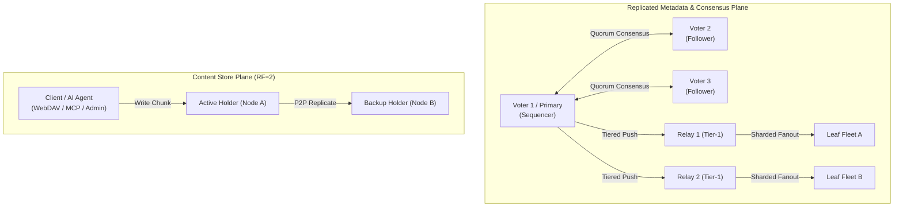

# p2p-storage — Distributed Resilient P2P Storage System

A decentralized, high-performance peer-to-peer storage system designed for deep hierarchy access, multi-agent AI workflows, and zero-single-point-of-failure durability.

Every participating node runs a lightweight containerized agent (`node-agent`) contributing local content storage and maintaining a synchronized replica of the hierarchy metadata. 

### Key Capabilities

- **Durable Quorum Consensus**: Metadata operations are sequenced through a resilient Raft-style consensus log (`METADATA_VOTERS`) with majority-based Primary leadership and automatic election failover.
- **Content-Addressed Storage & $RF=2$ Redundancy**: Files are chunked into 4 MiB blocks, cryptographically hashed (SHA-256), encrypted at rest (AES-256-GCM), and placed across independent active and backup holders with self-healing read-repair.
- **Hierarchical Tiered Dissemination (Phase 8)**: Scale-out fanout tree with Tier-1 Relay nodes buffering updates to shield the Primary, supporting clusters beyond 1,000 containers with $O(1)$ Primary network egress.
- **Content-Addressed Checkpoints & Compaction**: Zero-downtime periodic metadata snapshots stored as encrypted content chunks, automatically compacting transaction logs and enabling fast cold-node onboarding.
- **Multi-Protocol Client Surface**:
  - **WebDAV Drive Mount**: Direct OS filesystem integration (Windows, macOS, Linux) with per-folder ACL inheritance.
  - **Model Context Protocol (MCP)**: Native JSON-RPC interface for autonomous AI agents to explore, search, read, and write files.
- **Production Hardening**: Full Noise protocol transport encryption, scrypt-based password hashing, Prometheus metrics exporter, and comprehensive auditability.

---

## Architecture Overview



---

## Quorum Durability Mode

For acknowledged-upload durability and safe automatic Primary failover, configure **three voter nodes**:

```powershell
$env:METADATA_VOTERS = "anchor1,node2,node3"
$env:NODE_NAME       = "anchor1" # node2 / node3 on respective machines
$env:REPLICATION_FACTOR = "2"
```

Terms, votes, pending log entries, commit progress, and metadata mutations are persisted in SQLite with `synchronous=FULL` and WAL journaling.

An upload reports success only after:
1. Every chunk has been hash-verified and persisted on two distinct nodes ($RF=2$).
2. The complete file metadata (chunk placement, manifest, and directory entry) is committed through a majority of the metadata voters and applied locally by the leader.
3. The receiving node has confirmed the committed metadata, ensuring read-your-writes consistency.

```bash
npm run test:durability
```

## Periodic background work

| Task | Default interval | Trigger / responsibility |
|------|------------------|--------------------------|
| Legacy metadata push | 1 second + changes | Primary pushes committed local changes; not a quorum durability guarantee |
| Quorum election / heartbeat | Election 600-1200 ms; heartbeat 100 ms | Fixed voters replicate the log, authorize one writer, and commit through a majority; RPC/proposal timeout 1500 ms |
| Cluster announcements | 5 seconds + peer connection | Advertise role, metadata progress, usage, and quota |
| Connectivity heartbeat | 5 seconds | Ping connected peers |
| Health detection | 5 seconds | Confirm stale peers with pings; suspect at ~7.5 seconds, down at ~15 seconds |
| Content reconciliation | 5 seconds + health events | Restore missing backup copies |
| Capacity rebalance | 10 seconds | Above 85%, move chunks toward 70% utilization |
| Availability retry | 1 second | A ready Primary repairs locations referencing peers already declared down |

Read-repair runs on reads, not as a scheduled integrity scrub.

## Documentation

- **[DEPLOYMENT.md](DEPLOYMENT.md)** — run across real machines (same-LAN works today; mesh-VPN/Tailscale steps).
- **[docs/DETAILED_DESIGN.md](docs/DETAILED_DESIGN.md)** — architecture, schemas, wire protocols, per-phase design.
- **[docs/IMPLEMENTATION_PLAN.md](docs/IMPLEMENTATION_PLAN.md)** — deployment target, phase rollout, decisions.
- **[docs/p2p-storage-proposal.md](docs/p2p-storage-proposal.md)** — the originating design proposal.

## Status

| Phase | Description | State |
|-------|-------------|-------|
| **0** | Walking skeleton: libp2p host, mDNS discovery, auto-dial, heartbeat, failure detection | ✅ done |
| **1** | Metadata replication (primary + log + snapshot, push/pull sync, SHA256 convergence) | ✅ done |
| **2** | Content store with RF=2 (chunking, replication to non-co-located backup, read-repair) | ✅ done |
| **3** | Availability: health detection, promotion, reconciler (self-heal to RF=2), leader election | ✅ done |
| **4** | Capacity: rebalance (two-threshold hysteresis, RF-preserving offload) + admission control | ✅ done |
| **5** | Client surface: **WebDAV mount** + per-folder **ACL enforcement** (Basic auth; anonymous when `*` granted) | ✅ done |
| **5.5** | Cross-network: `BOOTSTRAP_PEERS` dialing, persistent identity, `ANNOUNCE_MULTIADDRS`, mDNS toggle (mesh-VPN ready) | ✅ done |
| **6** | MCP endpoint for AI agents (JSON-RPC over HTTP; same routing/ACL path as WebDAV) | ✅ done |
| **7** | Hardening (encryption-at-rest, scrypt password hashing, admin auth & ACL enforcement, Prometheus metrics, proactive rotation) | ✅ done |
| **8** | Tiered scaling & periodic checkpointing (config file support, max containers limit, hierarchical relay fanout, content-addressed snapshots) | ✅ done |

## Tech stack

- **Node.js 24 + TypeScript**
- **[js-libp2p](https://github.com/libp2p/js-libp2p)** — TCP transport, Noise encryption, Yamux
  muxing, mDNS + bootstrap discovery, identify + ping services.
- **Built-in `node:sqlite`** for the replicated metadata store (no native build step).

## What Phase 1 does

One node is the **Primary** (single writer, `IS_PRIMARY=true`). It owns an append-only metadata
log; every namespace change (create/delete folder, …) is applied + logged + assigned a monotonic
`lsn` atomically, then **pushed** to replicas. Replicas verify `lsn` contiguity and a **SHA-256**
over the whole replicated state; any gap or mismatch makes them **pull** (snapshot + delta) until
their hash matches the Primary again — "verify before serve". Result: every node holds a
byte-identical copy of the hierarchy, and a fresh or corrupted node self-heals to convergence.

Each node exposes an **admin/debug HTTP API** (`ADMIN_PORT`, default `8080`) — the seed of the
eventual WebDAV/web-UI surface:

| Method & path | Purpose |
|---------------|---------|
| `GET  /admin/status` | `{ peerId, name, isPrimary, mode, lsn, sha256, usedBytes, peers }` |
| `GET  /admin/tree`   | recursive folder/file tree |
| `POST /admin/mkcol`  | `{ "path": "/A/B" }` → create folder (routes to Primary) |
| `POST /admin/rmdir`  | `{ "path": "/A/B" }` → delete empty folder |
| `POST /admin/corrupt`| test-only: diverge local DB to exercise the fallback pull |

## What Phase 2 adds — content storage @ RF=2

Files now carry **bytes**, not just metadata. A write is **chunked** (content-addressed by
`sha256`, fixed size, `CHUNK_SIZE_BYTES` default 4 MiB), each chunk stored on disk under a 2-level
fan-out, and the file is registered with the Primary as a **manifest** (ordered chunk list) plus a
per-chunk **location** row.

Replication factor **2** means every chunk lives on **two different PCs**: the node that received the
write becomes the **active** holder, and each chunk is copied to a **backup** peer chosen by
least-utilization (`active != backup`). Both copies must finish before the file metadata is registered
and success is returned. A failed backup does not publish an incomplete overwrite. Reads
reassemble the file from its chunks, serving each from local disk when present — **verifying
integrity on every read** — otherwise fetching from a holder. A locally **corrupt** chunk is
transparently **read-repaired** from the good replica. The upshot: **any single PC can fail or
corrupt a chunk with zero data loss.**

Additional admin endpoints (the seed of the eventual WebDAV surface):

| Method & path | Purpose |
|---------------|---------|
| `PUT  /admin/file?path=/A/f` | raw request body → chunk, store, replicate (RF=2) |
| `GET  /admin/file?path=/A/f` | stream the file's bytes back (read-repairs on the fly) |
| `GET  /admin/chunks` | `{ peerId, count, hashes[] }` — chunks held locally |
| `GET  /admin/locations` | chunk → `{ active_peer, backup_peer, state }` map |
| `GET  /admin/health` | per-peer `up` / `suspect` / `down` liveness (Phase 3) |
| `POST /admin/reconcile` | force a reconcile sweep (Phase 3 test hook) |
| `GET  /admin/capacity` | per-node used/quota/free + cluster admission headroom (Phase 4) |
| `POST /admin/rebalance` | force a capacity offload sweep (Phase 4 test hook) |
| `POST /admin/corrupt-chunk?hash=…` | test-only: corrupt a local chunk to exercise read-repair |

## What Phase 3 adds — availability & self-healing

The cluster now **survives node failures on its own**. Each node turns the gossip view into explicit
per-peer liveness (`up` → `suspect` → `down`, confirmed with a bounded ping) via a **health detector**.

When a peer goes **down**, three things happen:

- **Promotion** (Primary, `§8.2`): the Primary rewrites any chunk `location` whose only live copy
  pointed at the dead node — the surviving **backup becomes active** (`state='degraded'`), and a lost
  backup is cleared. No chunk is ever left pointing solely at a dead PC.
- **Reconciler** (every node, `§9`): the node that is now the active holder of a `degraded` chunk
  copies it to a fresh **healthy** peer (placement skips nodes believed down) and flips the location
  back to `state='ok'` — **restoring RF=2 automatically**.
- **Leader election** (`§8.3`): if the **Primary** itself dies, every replica runs the *same*
  deterministic election over the gossip view — highest committed `lsn`, then anchor role, then lowest
  `peerId` — so they agree on a winner **without voting**. The winner bumps the term (`epoch`), assumes
  the Primary role (creates its meta-log, switches to push), repairs locations off the dead Primary,
  and keeps serving. A monotonic `epoch` + deterministic step-down resolves any brief split-brain.

The historical deterministic election above applies only to legacy mode and is not partition-safe.
For durable acknowledgment and majority-authorized failover, use **Durable three-voter mode**.
Restoring RF=2 after a failure additionally requires a distinct healthy destination with spare capacity.

## What Phase 4 adds — capacity management

Nodes now **respect their storage budget** so no single PC fills up while others sit idle.

- **Rebalance / offload** (`§10`, every caught-up node): each node watches its own usage against its
  quota with **two-threshold hysteresis** — `REBALANCE_HIGH` (start, default 85%) and `REBALANCE_LOW`
  (stop, default 70%). Above the high-water mark it offloads its **largest chunks first** to the
  least-utilized healthy peer with room, until it drops back under the low-water mark. The gap between
  the two marks damps oscillation. **RF=2 is preserved throughout**: only *one* of a chunk's two copies
  is moved, and the local copy is deleted **only after** the location map commits via the Primary
  (`relocateActive` if this node held the active copy, keeping the existing backup; `setBackup` if it
  held the backup). Chunks not `state='ok'`, or whose other copy is on an unhealthy node, are skipped.
- **Admission control** (`§10`, on every write): a write is accepted only if the cluster can actually
  hold **RF copies** of it — the active copy lands wholly on the writing node (so it needs room for the
  whole file), the cluster needs `RF×size` free overall, and at least `RF` distinct healthy nodes need
  room. Otherwise the write is rejected up-front with **HTTP `507` + `code: ENOSPC`** instead of silently
  under-replicating.
- **Warm-cache is quota-aware**: opportunistic read-caching of chunks a node doesn't own only happens
  while it is below the low-water mark, so serving reads never re-creates the pressure the rebalancer
  just relieved.

Inspect any node's view with `GET /admin/capacity`; force a sweep with `POST /admin/rebalance`.

## What Phase 5 adds — WebDAV mount + per-folder ACL

The drive is now a **real mountable filesystem**. Each node can run a **WebDAV server**
(`WEBDAV_PORT`, default `8090`; opt-in via `WEBDAV_ENABLED=true`) that maps the replicated hierarchy to
standard WebDAV verbs, so Windows Explorer, macOS Finder, Linux `davfs2`/GVfs — or any WebDAV client —
can **map a network drive** and browse folders, read/write files, rename, and delete, all backed by the
RF=2 content store and replicated metadata underneath (`§12`).

- **Full class-2 WebDAV surface:** `OPTIONS`, `PROPFIND` (Depth 0/1 multistatus), `GET`/`HEAD`
  (+ an HTML listing for browsers), `PUT` (new → `201`, overwrite → `204`), `MKCOL`, `DELETE`
  (**recursive**), `MOVE`, `COPY` (files + recursive folders), `PROPPATCH` (best-effort), and advisory
  `LOCK`/`UNLOCK`. Writes route to the Primary and are **read-your-writes consistent** on the writing
  node (an immediate `GET` after a `PUT` on the same node never sees stale bytes).
- **Per-folder ACLs, replicated with the metadata (`§13`):** every folder/file points at an ACL
  (`acl_id`); a file with no own ACL **inherits** the nearest ancestor folder's ACL up to the root. The
  root grants world `*=rwx` by default, so the drive is open until you lock a subtree down. An ACL is a
  list of `{ principal, rights }` where `principal` is `*` (everyone), a username, or a group name, and
  `rights ⊆ { read, write }`. Set one with `POST /admin/acl { "path": "/private", "rules": [...] }` — it
  allocates the ACL, points the folder at it, and replicates like any other metadata op, so **every node
  enforces the same ACL**.
- **Authentication:** HTTP **Basic** against `WEBDAV_USERS` (`user:pass:group1|group2,…`). An
  authenticated request matches `*`, its own username, and its groups; an **anonymous** request matches
  only `*`. On failure an anonymous caller gets **`401`** + a `WWW-Authenticate` challenge, an
  authenticated-but-unauthorized caller gets **`403`**, and bad credentials get **`401`**. Set
  `WEBDAV_ALLOW_ANON=false` to force authentication even where an ACL grants `*`.

| Method & path | Purpose |
|---------------|---------|
| `POST /admin/acl` | `{ "path": "/A/B", "rules": [{ "principal": "alice", "rights": ["read","write"] }] }` → set a folder/file ACL (routes to Primary, replicates) |

### Mount the drive

With a node's WebDAV server reachable at `http://<host>:8090/` (Docker publishes **8091 / 8092 / 8093**):

- **Windows** — Explorer → *Map network drive*, or:
  ```powershell
  net use Z: http://localhost:8091/ /user:alice secret
  ```
  Basic auth over plain HTTP needs the WebClient service's `BasicAuthLevel` registry value set to `2`
  (then restart the *WebClient* service); the default `FileSizeLimitInBytes` (~50 MB) may also need
  raising for large files.
- **macOS** — Finder → *Go → Connect to Server* → `http://localhost:8091/`.
- **Linux** — `sudo mount -t davfs http://localhost:8091/ /mnt/drive` (davfs2).

> All three published ports serve the **same global namespace** and enforce the **same ACLs** — mount
> whichever node is nearest.

## What Phase 6 adds — MCP endpoint for AI agents

The drive is now a **first-class tool surface for AI agents** via the **Model Context Protocol**. Each
node can run an **MCP server** (`MCP_PORT`, default `8100`; opt-in via `MCP_ENABLED=true`) that speaks
MCP **JSON-RPC 2.0 over HTTP** (Streamable-HTTP transport: one JSON-RPC request per POST). Any MCP
client — Claude Desktop, the MCP Inspector, or an in-house agent — can connect, discover the tools, and
list/read/write files. It runs the **same routing/ACL path** as WebDAV, so AI is a first-class client
alongside human mounts (`§14`).

- **Handshake & discovery:** `initialize` (advertises `protocolVersion` + `serverInfo` and `tools`
  capability), `notifications/initialized` (acknowledged with `202`, no body), `tools/list`, and
  `ping`. Batches and unknown notifications are handled per JSON-RPC.
- **Six tools:** `list_folder`, `stat_file`, `read_file`, and `search` answer **locally** from the
  metadata replica / content service (read-repaired on the fly); `create_folder` and `write_file`
  **route to the Primary** through the replication write-intent path. `read_file`/`write_file` take an
  `encoding` of `utf8` (default) or `base64` for binary. Tool-level failures (missing file, no space)
  come back as `isError: true` content, not transport errors; malformed calls get JSON-RPC `-32602`.
- **Auth & ACL — identical to WebDAV:** HTTP **Basic** against `MCP_USERS` (defaults to `WEBDAV_USERS`).
  A wrong/absent credential is challenged with **`401`**; every tool call is then authorized against the
  effective per-folder ACL before any metadata or content is touched. `search` **omits files the caller
  may not read**, so it never leaks locked-down paths. Set `MCP_ALLOW_ANON=false` to require auth even
  where an ACL grants `*`.

| Tool | Right | Purpose |
|------|-------|---------|
| `list_folder` | read | List child folders + files of a path |
| `stat_file` | read | File/folder metadata (size, content type, timestamps) |
| `read_file` | read | File bytes (`utf8` or `base64`), read-repaired |
| `search` | read | Find files whose path matches a query (ACL-filtered) |
| `create_folder` | write | Create a folder path (routes to Primary) |
| `write_file` | write | Create/overwrite a file (chunk + RF=2 replicate) |

Point an MCP client at `http://<host>:8100/` (Docker publishes **8101 / 8102 / 8103**). Example raw call:

```bash
curl -s -u alice:secret http://localhost:8101/ \
  -H 'content-type: application/json' \
  -d '{"jsonrpc":"2.0","id":1,"method":"tools/call",
       "params":{"name":"read_file","arguments":{"path":"/docs/report.txt"}}}'
```

## What Phase 7 adds — hardening, encryption & metrics

Phase 7 delivers production-grade security, observability, and data resiliency:

- **Encryption-at-rest (AES-256-GCM):** With `STORAGE_KEY` configured (64 hex characters = 32-byte key), every chunk stored on disk is encrypted via authenticated AES-256-GCM framing: `[12-byte nonce][ciphertext][16-byte auth tag]`. Plaintext hashes are preserved in metadata so content addressing remains deterministic. Reads decrypt and authenticate on the fly; tampered or damaged ciphertext fails the GCM auth tag and transparently triggers **read-repair** from healthy replicas. When `STORAGE_KEY` is omitted, chunk storage runs unencrypted for backward compatibility.
- **Password hashing (scrypt):** User password tables (`ADMIN_USERS`, `WEBDAV_USERS`, `MCP_USERS`) support hashed credentials via `node:crypto` scrypt: `$scrypt$N=16384,r=8,p=1$<salt-b64>$<hash-b64>`. Passwords can be generated via `node dist/auth/hash-password.js <password>`. Existing plaintext passwords remain supported for backward compatibility.
- **Admin authentication & ACL enforcement:** Setting `ADMIN_USERS` gates the `/admin/*` API with HTTP Basic authentication. Path-scoped administrative operations (`/admin/mkcol`, `/admin/rmdir`, `/admin/acl`) additionally enforce the `'admin'` ACL right, preventing unauthorized namespace modifications.
- **Prometheus metrics & observability:** Opt-in via `METRICS_ENABLED=true` (`METRICS_PORT`, default `9090`). Exposes a standard Prometheus `/metrics` text endpoint with gauges for stored chunks, bytes used, soft quota, peer connectivity by health state (`up`, `suspect`, `down`), metadata LSN, primary role, replication lag, and location states (`ok`, `degraded`, `replicating`), as well as monotonic counters for uploads, reads, repairs, relocations, and elections.
- **Proactive active/backup rotation:** Configurable via `ROTATION_INTERVAL_MS` and `ROTATION_BATCH` (default `8`). Periodically swaps healthy active and backup chunk holders on the Primary, exercising both copies under real read traffic and preventing passive replica bit rot.

## What Phase 8 adds — tiered scaling & periodic checkpointing

Phase 8 enables the cluster to scale past 100+ nodes up to 1,000 nodes without exhausting the Primary:

- **Unified Configuration File Support:** All node parameters can now be specified in a JSON configuration file (`config.json` or path via `CONFIG_FILE`), complete with sensible defaults and environment variable overrides. A reference `config.default.json` is provided in the repository root.
- **Cluster Capacity Guard (`MAX_CONTAINERS`):** Configurable maximum container limit (default `1,000`). Guarded within gossip and membership discovery to maintain stable cluster operations.
- **Hierarchical Tiered Relay Fanout:** When cluster size exceeds `TIER_SCALE_THRESHOLD` (default `100`) or when `TIER_ENABLED=true`, the cluster operates hierarchically:
  - **Tier-0 (Primary):** Pushes transaction batches only to designated Tier-1 Relay nodes (`O(R)` fanout, typically 3 to 5 anchors). Network egress complexity on the Primary drops from $O(N)$ to $O(1)$.
  - **Tier-1 (Relay Nodes):** Verify batches, apply locally, append to local transaction log, and fan out to their connected Tier-2 Leaf nodes.
  - **Tier-2 (Leaf Nodes):** Receive pushes from their relay; fallback pulls route to relays first, querying Primary only as a last resort. Writes from leaf nodes forward transparently through relays to the Primary.
- **Content-Addressed Periodic Checkpointing:** The Primary or Anchor node executes scheduled zero-downtime snapshots (`CHECKPOINT_INTERVAL_HOURS`, default `24`). The vacuumed SQLite database snapshot is chunked, encrypted, and stored directly in the cluster's distributed `ContentStore`.
- **Accelerated Cold Bootstrap & Log Compaction:** Joining containers and recovering nodes download the nearest checkpoint chunk in parallel from peer content holders rather than requesting a large database dump from the Primary. Once restored, they replay only the subsequent delta log slice from their nearest Tier-1 Relay. Historical entries in `meta_log` prior to active checkpoints are automatically pruned, bounding SQLite disk growth.

## Run locally (no Docker)

```bash
npm install
npm run build

# terminal 1 — the Primary
IS_PRIMARY=true NODE_ROLE=anchor ADMIN_PORT=8080 DATA_DIR=./data/a node dist/index.js
# terminal 2 — a replica
ADMIN_PORT=8081 DATA_DIR=./data/b node dist/index.js
```

On Windows PowerShell:
```powershell
$env:IS_PRIMARY="true"; $env:ADMIN_PORT="8080"; $env:DATA_DIR="./data/a"; node dist/index.js
```

Then drive it:
```bash
curl -X POST localhost:8080/admin/mkcol -d '{"path":"/docs/reports"}'
curl localhost:8081/admin/tree      # replica shows the same tree
curl localhost:8081/admin/status    # same sha256 as the Primary
```

### Phase 1 acceptance test

```bash
npm run test:phase1
```

Spawns a 4-process cluster and proves: (a) a Primary write propagates to all peers, (b) a
late-joining node pull-syncs, (c) a corrupted replica detects the mismatch, falls back to pull, and
re-converges — all ending on an identical `sha256`.

### Phase 2 acceptance test — RF=2 / no data loss

```bash
npm run test:phase2
```

Spawns a 3-node cluster (small `CHUNK_SIZE_BYTES` so a modest file yields several chunks) and proves:
(A) a written file is chunked and every chunk reaches **RF=2** (`state='ok'`, `active != backup`, and
each chunk physically present on ≥2 nodes); (B) **read-repair** — corrupting a chunk on the holder
still returns the correct bytes and fixes the local copy; (C) **no data loss** — after the **active**
node is killed, a surviving node still returns the exact original bytes from the backup. Against a
running Docker cluster, `P2P_NO_SPAWN=1 P2P_ADMIN_PORTS=8081,8082,8083 node test/phase2/run.mjs`
runs A and B (C, which kills a node, is skipped in external mode).

### Phase 3 acceptance test — self-heal & election

```bash
npm run test:phase3
```

Spawns a 4-node cluster (fast 1.5s heartbeat so failures are declared in seconds) and proves:
(**Part 1 — self-heal**) after the **active** holder of a file is killed, all survivors detect it
`down`, the Primary **promotes** the surviving backups to active, and each new active holder's
**reconciler** copies its chunks to a fresh healthy peer — **RF=2 is restored with zero data loss** and
no location references the dead node. (**Part 2 — election**, also enabled here) killing the **Primary**
itself makes every remaining replica independently compute the **same** new leader (deterministic, no
split-brain); the winner takes over, accepts **new** writes, and the original file — now having survived
**two** node failures — still reads back byte-for-byte.

### Phase 4 acceptance test — capacity management

```bash
npm run test:phase4
```

Spawns a 3-node cluster with a **small equal quota** (16 chunks/node) and proves:
(**Part A — rebalance**) a write that pushes the writer over the 85% high-water mark, followed by a
`POST /admin/rebalance`, drops it back under the 70% low-water mark while **every chunk stays at RF=2**
(`state='ok'`, `active != backup`) and the file still reads back byte-for-byte — and a **second** sweep
moves nothing (no oscillation). (**Part B — admission**) a single over-quota write is rejected up-front
with **`507` / `ENOSPC`**, filling the cluster with small writes eventually makes admission reject with
`507` as well, and the Part-A file still reads correctly under a full cluster.

### Phase 5 acceptance test — WebDAV protocol + ACL enforcement

```bash
npm run test:phase5
```

Spawns a 3-node cluster with WebDAV enabled and drives **real WebDAV verbs over HTTP**, proving:
(**Part A — protocol**) `OPTIONS` advertises DAV class 1+2; `MKCOL`, `PUT` (new → `201`, overwrite →
`204`), `GET` (byte-for-byte), `HEAD`, `PROPFIND` (Depth-1 multistatus), `MOVE`, `COPY`, and `DELETE`
— including **recursive** delete of a non-empty folder — all behave per spec. (**Part B —
replication**) a binary file `PUT` on node2 reaches **RF=2**, and node3 serves the **same bytes** back
and lists it via `PROPFIND`, proving the mount is backed by the replicated cluster, not local disk.
(**Part C — ACL**) after locking `/private` (alice `rwx`, group `staff` read-only) via
`POST /admin/acl`, anonymous reads get **`401`**, an out-of-ACL user gets **`403`**, a `staff` member
reads (`200`) but cannot write (`403`), a wrong password gets **`401`**, and the **same ACL is enforced
on node3** — confirming ACLs replicate with the metadata.

### Phase 5.5 acceptance test — cross-network networking

```bash
npm run test:phase5.5
```

Proves the mesh-VPN building blocks without a real VPN: (**Test A — persistent identity**) a node is
spawned, its `peerId` recorded, killed, and respawned on the **same `DATA_DIR`** — the `peerId` is
**identical**, confirming the key persists at `DATA_DIR/identity/node.key`. (**Test B — bootstrap-only
discovery**) two nodes start with **`MDNS_ENABLED=false`**; the replica is given only the primary's
`BOOTSTRAP_PEERS` multiaddr and `ANNOUNCE_MULTIADDRS` set to the announced address — they still
**connect purely via bootstrap** (no multicast) and a subsequent primary write **propagates** to the
replica, exactly the Path B (mesh-VPN) scenario.

### Phase 6 acceptance test — MCP endpoint for AI agents

```bash
npm run test:phase6         # full 3-node cluster, MCP driven over JSON-RPC
npm run test:phase6:unit    # fast, libp2p-free unit harness for the MCP layer
```

`test:phase6` spawns a 3-node cluster with MCP enabled and drives **real MCP JSON-RPC over HTTP**:
(**Part A**) `initialize` returns `serverInfo` + `protocolVersion`, `notifications/initialized` → `202`,
`tools/list` advertises the six tools, `ping` answers. (**Part B**) `create_folder` + `write_file`, then
`list_folder`/`stat_file`/`read_file` round-trip **byte-for-byte** and `search` finds the file; a missing
read comes back as a graceful tool error. (**Part C**) a multi-chunk `write_file` reaches **RF=2** and
`read_file` on **node3** returns the same bytes. (**Part D**) after locking `/vault` (alice `rwx`, group
`staff` read-only), anonymous is **denied**, an out-of-ACL user gets a tool error, a `staff` member reads
but cannot write, `search` **hides** files the caller can't read, a wrong password gets **`401`**, and the
**same ACL is enforced on node3**.

`test:phase6:unit` wires the real `McpApi` + `MetadataStore` + `BasicAuth` to lightweight content/
replication fakes and exercises the whole protocol + ACL surface **without the p2p stack** — it runs in
seconds and is handy where loading libp2p is slow.

### Phase 7 acceptance test — hardening & encryption

```bash
npm run test:phase7
```

Spawns a 3-node cluster with `STORAGE_KEY` set and verifies:
- **Test A:** Uploads under `STORAGE_KEY` chunk and replicate to **RF=2** (`state='ok'`, `active != backup`).
- **Test B:** On-disk chunk files are **ciphertext** (length is plaintext + 28 bytes framing; none hashes to its chunk hash).
- **Test C:** Reads decrypt and return the exact original plaintext across all nodes.
- **Test D:** Tampering with on-disk ciphertext fails the GCM auth tag and triggers transparent **read-repair** from the good backup replica.
- **Test E:** Killing the active holder allows seamless reads from the encrypted backup (**no data loss**).
- **Test F:** Setting `ADMIN_USERS` enforces HTTP Basic auth on the `/admin/*` API (unauthenticated requests and invalid passwords return `401`, valid credentials return `200`).
- **Test F2:** Scrapes Prometheus `/metrics` on `METRICS_PORT`, verifying gauges and incrementing counters (`p2p_uploads_total`, `p2p_reads_total`).

### Phase 8 acceptance test — tiered scaling & checkpoint bootstrap

```bash
npm run test:phase8
```

Spawns a multi-tier cluster (Primary $\to$ Tier-1 Relay $\to$ Tier-2 Leaves) and verifies:
- Configuration file loading (`config.json` / `CONFIG_FILE`) with env overrides.
- Hierarchical push dissemination from Primary through Relays down to Leaf nodes.
- Convergence across all tiers to identical LSN and SHA-256 without point-to-point Primary connections.
- Cold node bootstrap from a content-addressed checkpoint chunk without Primary bottleneck.
- Live post-bootstrap mutation propagation.

### Run with Docker Compose
# admin APIs are published on the host: anchor1=8081, node2=8082, node3=8083

# run the same acceptance checks against the containers:
P2P_NO_SPAWN=1 P2P_ADMIN_PORTS=8081,8082,8083 node test/phase1/run.mjs

npm run docker:down    # stop + remove volumes
```

`anchor1` is the Primary (`IS_PRIMARY=true`); all three share a bridge network (approximating a LAN)
and discover each other over mDNS.

## Run on real PCs

Run **one** node per machine (exactly one with `IS_PRIMARY=true` for v1). Two supported network modes:

- **Same LAN (works today):** just run the node — mDNS discovery needs no extra setup.
- **Across the internet, no public IP (recommended target):** put all PCs on a mesh VPN
  (Tailscale / WireGuard / Nebula). Each PC gets a stable overlay IP; peers connect via
  `BOOTSTRAP_PEERS` (set `MDNS_ENABLED=false` and `ANNOUNCE_MULTIADDRS` to the overlay IP). ✅ Bootstrap
  dialing + persistent identity + announce are implemented and covered by `npm run test:phase5.5`.

**Step-by-step for both modes (firewall, verify, mount, troubleshooting): [DEPLOYMENT.md](DEPLOYMENT.md).**

## Configuration (environment variables)

| Var | Default | Meaning |
|-----|---------|---------|
| `NODE_NAME` | hostname | Log-friendly node name |
| `NODE_ROLE` | `ordinary` | `anchor` for the always-available seed/primary nodes |
| `IS_PRIMARY` | `false` | This node is the metadata Primary (single writer). Exactly one for v1 |
| `METADATA_VOTERS` | _(empty: legacy)_ | Exactly three distinct stable `NODE_NAME` values, including self. Same roster on all nodes; enables quorum durability and supersedes `IS_PRIMARY` |
| `LISTEN_PORT` | `0` (random) | libp2p TCP port (`4001` in Docker) |
| `ADMIN_PORT` | `8080` | Admin/debug HTTP API port |
| `ADMIN_USERS` | _(empty)_ | Raw user table gating the admin API (`user:pass:group1\|group2,other:pass`). Supports scrypt hashes. When empty, admin API is open (dev mode) |
| `ADMIN_REALM` | `p2p-admin` | HTTP Basic auth realm for the admin API |
| `STORAGE_KEY` | _(unset)_ | 64 hex characters (32 bytes) AES-256-GCM encryption-at-rest key. When unset, chunks are stored unencrypted |
| `METRICS_ENABLED` | `false` | Expose Prometheus-compatible `/metrics` scrape endpoint |
| `METRICS_PORT` | `9090` | HTTP port for the Prometheus metrics endpoint |
| `ROTATION_INTERVAL_MS` | `0` (disabled) | Sweep interval for proactive passive→active chunk rotation; 0 disables |
| `ROTATION_BATCH` | `8` | Maximum chunks rotated per sweep |
| `DATA_DIR` | `./data` | Root data dir; metadata db at `DATA_DIR/meta/meta.db`, chunks at `DATA_DIR/content`, persistent libp2p key at `DATA_DIR/identity/node.key` |
| `BOOTSTRAP_PEERS` | _(empty)_ | Comma-separated `/ip4/…/tcp/…/p2p/<peerId>` multiaddrs, dialed on startup (internet/VPN mode) |
| `ANNOUNCE_MULTIADDRS` | _(empty)_ | Comma-separated multiaddrs this node advertises (set to the VPN/overlay IP so peers dial a reachable address) |
| `MDNS_ENABLED` | `true` | Multicast LAN discovery; set `false` for bootstrap-only discovery over a VPN |
| `PUSH_INTERVAL_MS` | `1000` | Primary push sweep interval |
| `BATCH_SIZE` | `500` | Max ops per push/pull batch |
| `STORAGE_QUOTA_GB` | `20` | Content store soft quota |
| `STORAGE_QUOTA_BYTES` | _(unset)_ | Byte-level quota override (takes precedence over `STORAGE_QUOTA_GB`; for small test quotas) |
| `REPLICATION_FACTOR` | `2` | Copies per drive |
| `CHUNK_SIZE_BYTES` | `4194304` | Fixed chunk size (4 MiB); lower it to force multi-chunk files in tests |
| `HEARTBEAT_INTERVAL_MS` | `5000` | Heartbeat/ping + gossip interval |
| `HEALTH_DETECT_INTERVAL_MS` | heartbeat | Health sweep interval |
| `HEALTH_SUSPECT_MS` / `HEALTH_DOWN_MS` | `1.5x` / `3x` heartbeat | Peer-staleness thresholds, confirmed by ping |
| `RECONCILE_INTERVAL_MS` | heartbeat | Restore missing backups; `0` disables periodic repair |
| `RECONCILE_BATCH` | `32` | Maximum degraded chunks repaired per sweep |
| `REBALANCE_ENABLED` | `true` | Run the periodic capacity offload sweep (Phase 4) |
| `REBALANCE_HIGH` | `0.85` | High-water mark: start offloading above this fraction of quota |
| `REBALANCE_LOW` | `0.70` | Low-water mark: stop offloading below this fraction of quota |
| `REBALANCE_INTERVAL_MS` | `2×heartbeat` | Capacity sweep interval |
| `WEBDAV_ENABLED` | `false` | Start the WebDAV server (opt-in; binds `WEBDAV_PORT`). Off by default so multiple nodes can share a host |
| `WEBDAV_PORT` | `8090` | WebDAV HTTP port (published as 8091/8092/8093 in Docker) |
| `WEBDAV_REALM` | `p2p-drive` | Basic-auth realm shown in the client login prompt |
| `WEBDAV_USERS` | _(empty)_ | Accounts for Basic auth: `user:pass:group1\|group2,other:pass` |
| `WEBDAV_ALLOW_ANON` | `true` | Allow unauthenticated access where an ACL grants `*` |
| `MCP_ENABLED` | `false` | Start the MCP endpoint for AI agents (opt-in; binds `MCP_PORT`) |
| `MCP_PORT` | `8100` | MCP JSON-RPC HTTP port (published as 8101/8102/8103 in Docker) |
| `MCP_REALM` | `WEBDAV_REALM` | Basic-auth realm shown to MCP clients |
| `MCP_USERS` | `WEBDAV_USERS` | Accounts for MCP Basic auth (same format; defaults to the WebDAV table) |
| `MCP_ALLOW_ANON` | `WEBDAV_ALLOW_ANON` | Allow unauthenticated MCP access where an ACL grants `*` |
| `CONFIG_FILE` | _(empty)_ | Path to JSON config file (e.g. `config.json`), merging with env overrides |
| `MAX_CONTAINERS` | `1000` | Maximum container/node capacity limit for cluster membership |
| `TIER_ENABLED` | `false` | Enable hierarchical tiered relay dissemination |
| `TIER_ROLE` | `auto` | Node tier role: `relay` (Tier-1), `leaf` (Tier-2), or `auto` |
| `TIER_SCALE_THRESHOLD` | `100` | Node count threshold above which auto-tiering activates |
| `RELAY_ROSTER` | _(empty)_ | Comma-separated list of node names acting as Tier-1 Relays |
| `CHECKPOINT_INTERVAL_HOURS` | `24` | Interval in hours between automated metadata checkpoints |
| `CHECKPOINT_RETENTION_DAYS` | `7` | Retention period in days for historical checkpoint chunks |
| `DELTA_LOG_RETENTION_OPS` | `10000` | Operations retained in `meta_log` after checkpoint compaction |

## Layout

```
src/
  config.ts            env-driven configuration
  logger.ts            minimal structured logger
  index.ts             entrypoint: host + metadata store + replication + admin API
  p2p/
    host.ts            libp2p host construction (transport/discovery/services)
    protocols.ts       protocol IDs + length-prefixed JSON RPC (rpc/handle)
    announce.ts        gossip + soft cluster view (finds the Primary, tracks peer lsn/epoch)
    health.ts          per-peer liveness detector (up/suspect/down, bounded ping)
  metadata/
    types.ts           op union + record types
    store.ts           node:sqlite store; apply(op); sha256(); snapshot/load
    log.ts             primary-only append-only meta log
    checkpoint.ts      periodic content-addressed snapshots + log compaction
  content/
    chunker.ts         fixed-size content-addressed chunking + hashing
    store.ts           on-disk chunk store (2-level fan-out, integrity-verified)
    transfer.ts        binary chunk push/pull protocols (content-put / content-get)
    service.ts         RF=2 write/read paths, placement, backup replication, read-repair, reconciler
  replication/
    service.ts         push/pull state machine + snapshot serve/fetch + promotion + become/step-down
  availability/
    service.ts         wires health detector → promotion + reconcile (Primary-driven self-heal)
    election.ts        deterministic leader election when the Primary dies (lsn/role/peerId)
  rebalance/
    service.ts         capacity offload sweep (two-threshold hysteresis, RF-preserving relocate)
  acl/
    acl.ts             per-folder ACL resolution (inherit up the tree) + read/write checks
  auth/
    basic.ts           HTTP Basic auth (parse user tables, scrypt hash + verify, decode header → principal)
    hash-password.ts   CLI helper to generate scrypt hashed passwords
  api/
    admin.ts           admin/debug HTTP API (status/tree/mkcol/rmdir/file/chunks/locations/health/reconcile/capacity/rebalance/acl)
    webdav.ts          WebDAV server (OPTIONS/PROPFIND/GET/HEAD/PUT/MKCOL/DELETE/MOVE/COPY/LOCK) + auth + ACL enforcement
    mcp.ts             MCP JSON-RPC server (initialize/tools/list/tools/call: list_folder/stat_file/read_file/search/create_folder/write_file) + auth + ACL enforcement
    metrics.ts         Prometheus /metrics endpoint (Phase 7 gauges + monotonic counters)
    counters.ts        in-process monotonic event counters registry
test/
  phase1/run.mjs       Phase 1 acceptance harness (metadata convergence)
  phase2/run.mjs       Phase 2 acceptance harness (RF=2 / read-repair / no data loss)
  phase3/run.mjs       Phase 3 acceptance harness (self-heal to RF=2 + leader election)
  phase4/run.mjs       Phase 4 acceptance harness (rebalance hysteresis + admission control)
  phase5/run.mjs       Phase 5 acceptance harness (WebDAV protocol + RF=2 mount + ACL enforcement)
  phase6/run.mjs       Phase 6 acceptance harness (MCP over JSON-RPC + RF=2 + ACL enforcement)
  phase6/mcp-unit.mjs  Phase 6 fast unit harness for the MCP layer (no libp2p)
  phase7/run.mjs       Phase 7 acceptance harness (encryption-at-rest, admin auth, metrics, read-repair)
deploy/
  Dockerfile
  docker-compose.yml
```
