# Distributed MCP-Enabled Storage System Using Resilient Peer Containers with Replicated Metadata for Scalable Deep Hierarchy Access

---

## 1. Problem Statement

Distributed storage systems spread data across multiple containers for scalability. However, **hierarchy metadata** — folder structure, file metadata (name, extension, size, type), ACLs, ownership, and content-location mapping — becomes a centralized or constrained resource, creating a bottleneck:

- **High load on metadata nodes** — all clients funnel through the same path.
- **Increased latency** — hierarchy lookups must traverse centralized nodes.
- **Poor scalability** — adding users amplifies pressure on metadata nodes.
- **Reduced availability** — if the metadata node goes down, the entire hierarchy is inaccessible.
- **Replication overhead** — frequent metadata updates increase replication traffic.

These issues are acute when containers are **scattered across a network** — on different VMs, regions, data centers, or even edge devices — where network latency, intermittent connectivity, power disruptions, and partial outages are routine.

---

## 2. Existing Solutions and Their Limitations

| Approach | How it works | Limitations |
|----------|-------------|-------------|
| **Centralized Metadata** | Single server handles all metadata | Single point of failure; bottleneck under load; any disruption renders the system unusable |
| **Partitioned (Sharded)** | Metadata split across nodes | Cross-node traversal for deep hierarchies; hotspots on popular folders; network partitions leave parts unreachable |
| **Full Replication** | Metadata replicated to all nodes | Every operation triggers replication; inefficient over high-latency links; replication storms |

**Key gap:** No existing system allows any container to serve the complete hierarchy independently while avoiding replication overhead — especially under real-world network instability and geographic distribution.

---

## 3. Proposed Solution

### 3.1 Core Thesis

A system of **symmetric peer containers** — each carrying equal responsibility and easily replaceable — scattered across a network, forming a **high-availability distributed data storage** accessible by both **users and AI agents**.

The design requires **no dedicated cloud infrastructure**. Containers can run on any machine connected over a network: different VMs in the same data center, different cloud regions, on-premises servers, or a mix. Every container is a peer — except for the elected primary (which is itself replaceable via leader election) and the snapshot cache.

### 3.2 Design Pillars

The architecture combines four innovations:

1. **Distributed Replicated Hierarchy Metadata** — every container stores a full copy of hierarchy metadata (folder structure, file metadata including name/extension/size/type, ACLs, ownership, content-location mapping). Any container can serve hierarchy requests independently.

2. **Decoupled Content Storage** — file contents are stored separately in content containers, each with a primary and backup copy. Metadata scaling is independent from content scaling.

3. **Load-Aware Entry Routing** — a routing layer directs AI or user requests to the least-loaded, most up-to-date container. Under partial outages, routing automatically redirects to healthy containers.

4. **Selective Metadata Updates** — only namespace-changing operations (folder create/delete/rename, permission changes) trigger metadata replication. Content operations (file create/update/delete) do not. This dramatically reduces replication traffic over bandwidth-constrained links.

### 3.3 Dual-Client Access: Users and AI

Every metadata-serving container exposes an **MCP (Model Context Protocol) endpoint** alongside traditional client interfaces. The Routing Service treats AI agents as first-class clients:

- **Users** connect via standard protocols for hierarchy browsing, content access, and updates.
- **AI agents** connect via the MCP endpoint to query hierarchy metadata, retrieve file metadata (name, extension, ACLs, type), and access content — using the same routing, load-balancing, and consistency guarantees as human users.
- The Routing Service can route an AI agent to **any available metadata-serving container**, just as it would for a user. There is no dedicated AI endpoint — the system is symmetric.

### 3.4 What Constitutes Metadata

Hierarchy metadata replicated across all containers includes:

| Category | Examples |
|----------|---------|
| **Folder structure** | Parent-child relationships, path hierarchy, nesting depth |
| **File metadata** | Name, extension, size, content type, creation/modification timestamps |
| **Access control** | ACLs, ownership, sharing permissions, role assignments |
| **Content-location mapping** | Which content container holds each file's primary and backup copies |

---

## 4. Container Architecture

Each container runs **co-located services** on the same VM/machine. These services handle data rebalancing, metadata synchronization, and resilience — without requiring external orchestration.

### 4.1 Services Per Container

| Service | Responsibility |
|---------|---------------|
| **Replication Service** | Maintains metadata consistency via push/pull sync |
| **Split Service** | Monitors utilization, rebalances content across containers |
| **Routing Service** | Directs clients (users and AI) to the right container |
| **MCP Service** | Exposes MCP endpoint for AI agents; classifies queries and serves or routes accordingly |
| **Availability Service** | Manages active-passive pairs, promotes passive copies, handles leader election |

All five services run on every container. The primary container additionally maintains the authoritative metadata log.

### 4.2 Routing Service

The Routing Service directs traffic based on request type, container health, and metadata freshness.

**Routing rules:**

| Request Type | Routing Target | Selection Criteria |
|-------------|----------------|-------------------|
| **Hierarchy read** | Any healthy container | ACL check, if permitted; latest metadata timestamp, then least-loaded |
| **Content access** | Content Container | ACL check, if permitted; resolved via content-location mapping (part of metadata) |
| **Metadata write** | Primary Container only | ACL check, if permitted; single authoritative writer |
| **Content write** | Content Container | ACL check, if permitted; write applied to content container only |
| **MCP query (AI)** | Any healthy container for metadata query; Content Container for content request | ACL check, if permitted; same criteria as hierarchy read and content access |

**Background management:**

- **Health monitoring** — detects unreachable containers, redirects traffic automatically.
- **Hot folder detection** — identifies folders with disproportionate access within same container, triggers Split Service to separate them across containers.
- **Replica management** — enables/disables metadata service on containers based on demand.

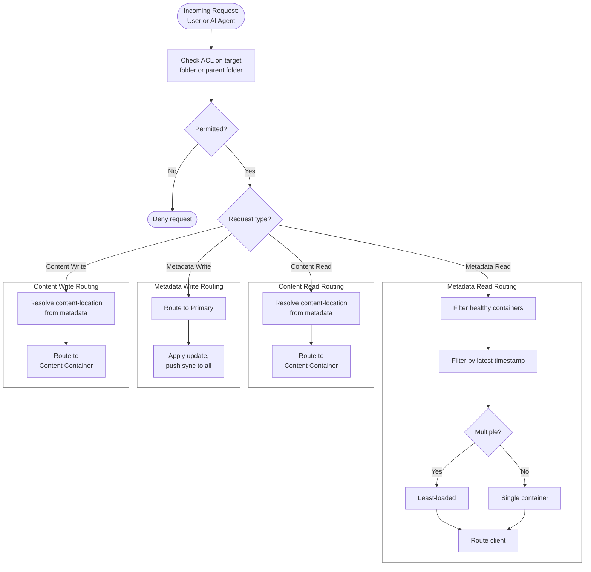

**Background monitoring:**

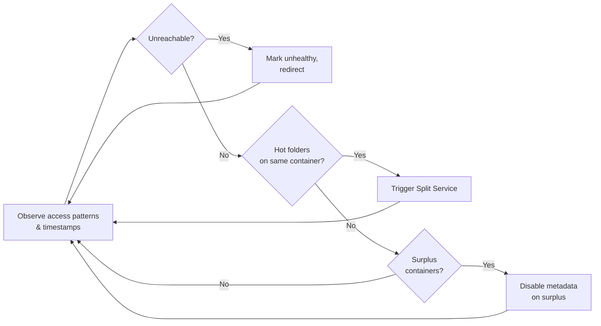

### 4.3 MCP Service

The MCP Service runs on every metadata-serving container, exposing an **MCP (Model Context Protocol) endpoint** that allows AI agents to query the distributed storage system. It classifies incoming AI queries and either answers them locally or routes to the appropriate container.

**Query classification:**

| Query Type | Example | Handling |
|-----------|---------|---------|
| **Metadata query** | "List all .pdf files in /Projects/Alpha", "Who owns this folder?", "What are the ACLs on /Reports?" | ACL check, if permitted; answered **locally** from the container's replicated metadata |
| **Content query** | "Read the contents of design-spec.pdf", "Summarize the document at /Reports/Q4.docx" | ACL check, if permitted; resolves content-location, **routes to the content container** |
| **Metadata write** | "Create a folder /Projects/Beta", "Update permissions on /Shared" | ACL check, if permitted; **routed to the Primary Container** |
| **Content write** | "Upload a file to /Projects/Alpha", "Update notes.txt" | ACL check, if permitted; resolves content-location, **routes to the Content Container** |

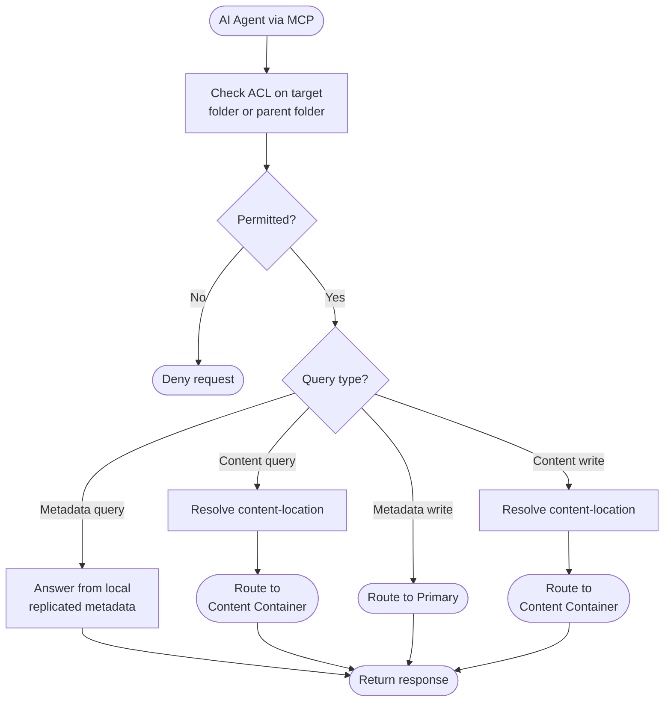

**Key properties:**

- **Metadata queries are local** — the AI agent gets instant responses for file listings, ACL checks, ownership queries, and file metadata (name, extension, size, type) without any cross-container communication.
- **Content queries are routed** — the MCP Service acts as an intelligent proxy, resolving where the content lives and directing the AI agent to the right content container.
- **Writes follow the same path as users** — both metadata and content writes go through ACL checks on the target folder (or parent folder for new items) before routing. Metadata writes go to Primary; content writes go to the Content Container. The AI agent does not get a special write path.
- **Any container can serve MCP** — the Routing Service picks the least-loaded, most up-to-date container for the AI agent, just as it would for a human user. If that container goes down, the agent is redirected to another.

### 4.4 Replication Service

Maintains metadata consistency using **two synchronization modes** and a **snapshot + log system**.

#### Push Synchronization (Steady State)

The primary container sends periodic update notifications:

1. Each notification contains: timestamp range `tsX` to `tsY`, the list of updates, and `SHA256(metadata)` of the resulting state.
2. Receiving container verifies its local timestamp == `tsX`, applies updates, computes `SHA256(metadata)` locally, and verifies the hash matches.
3. Only if the hash matches does the container advance its timestamp to `tsY`.

#### Pull Synchronization (Recovery)

Used when a container is new, recovering from an outage, or has detected corruption:

1. Load the latest serialized hierarchy snapshot from cache (with its timestamp).
2. Submit local timestamp to Primary.
3. Primary sends a batch of all updates after that timestamp (from its local incremental log).
4. Apply updates, advance timestamp, repeat until caught up.
5. Switch to push sync mode.

#### Fallback: Push to Pull

A container **must immediately fall back to pull sync** on any inconsistency: missed notification, timestamp gap, hash mismatch, network outage, or data corruption. It stops serving metadata, discards local state, reloads from snapshot, and catches up via pull sync.

#### Snapshot + Log System

- **Incremental log (on Primary):** Every namespace change is recorded with its timestamp. The log resides on Primary, ensuring CRUD operations and sync responses read from the same source.
- **Periodic snapshots (in cache):** Primary serializes metadata state into a binary blob stored in cache. Only snapshots go to cache — logs remain on Primary.
- **Retention:** Logs older than 2 snapshot cycles are purged. Late-returning containers reload from the latest snapshot.

**Pull Synchronization:**

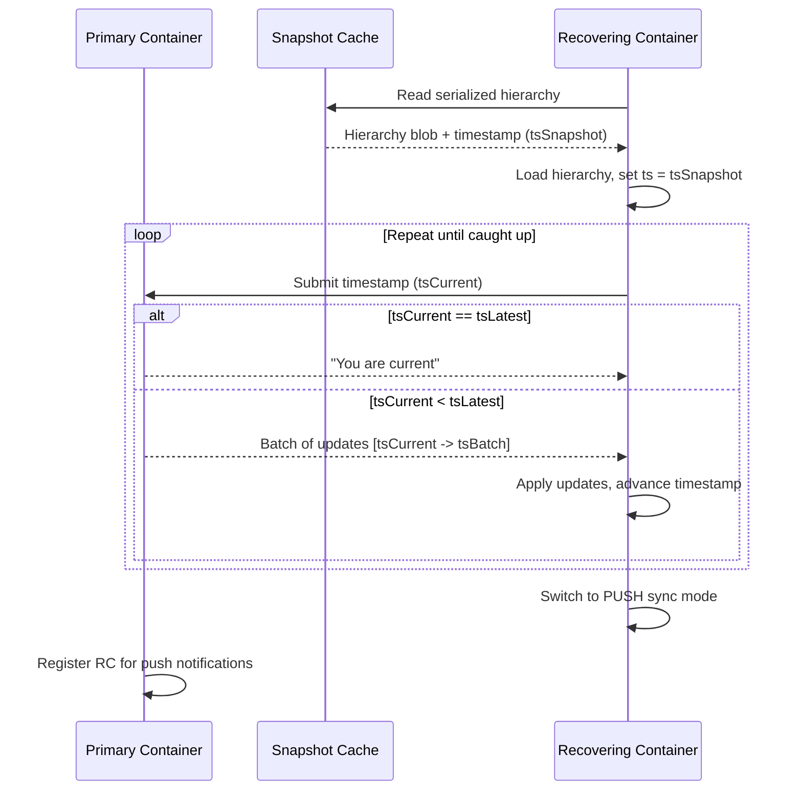

**Push Synchronization:**

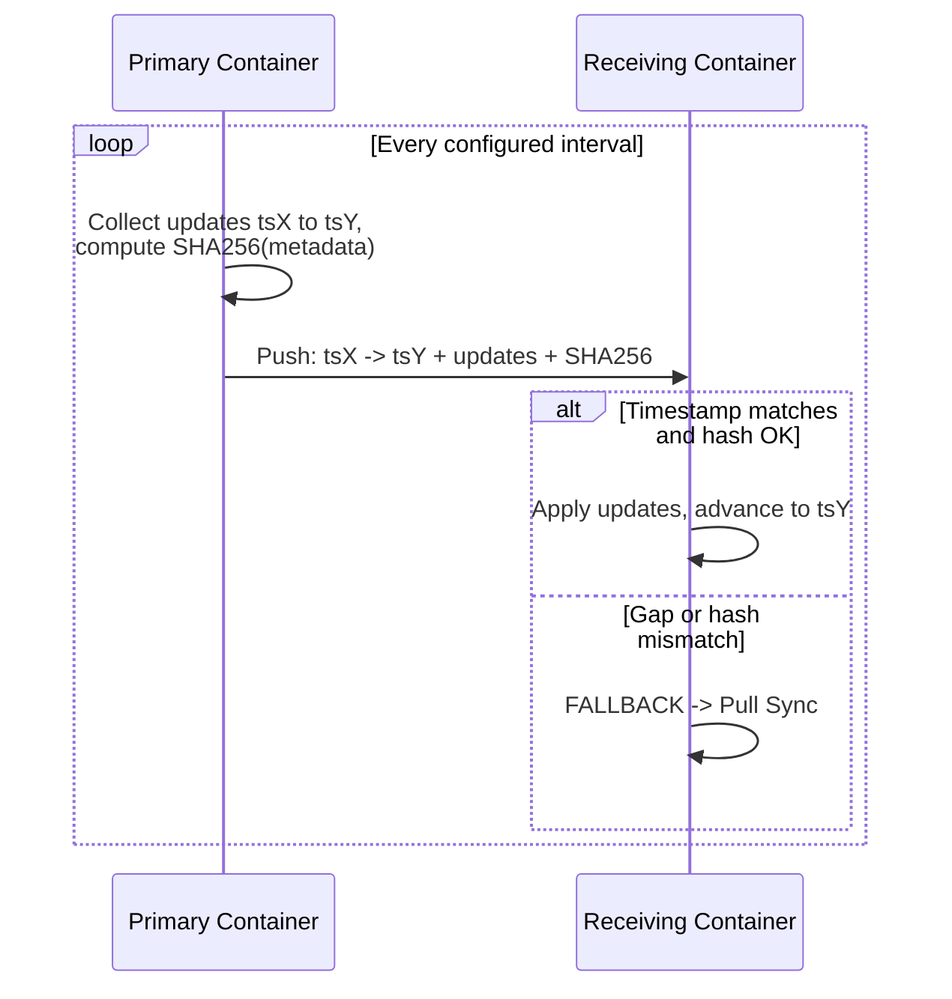

**Snapshot + Log Lifecycle:**

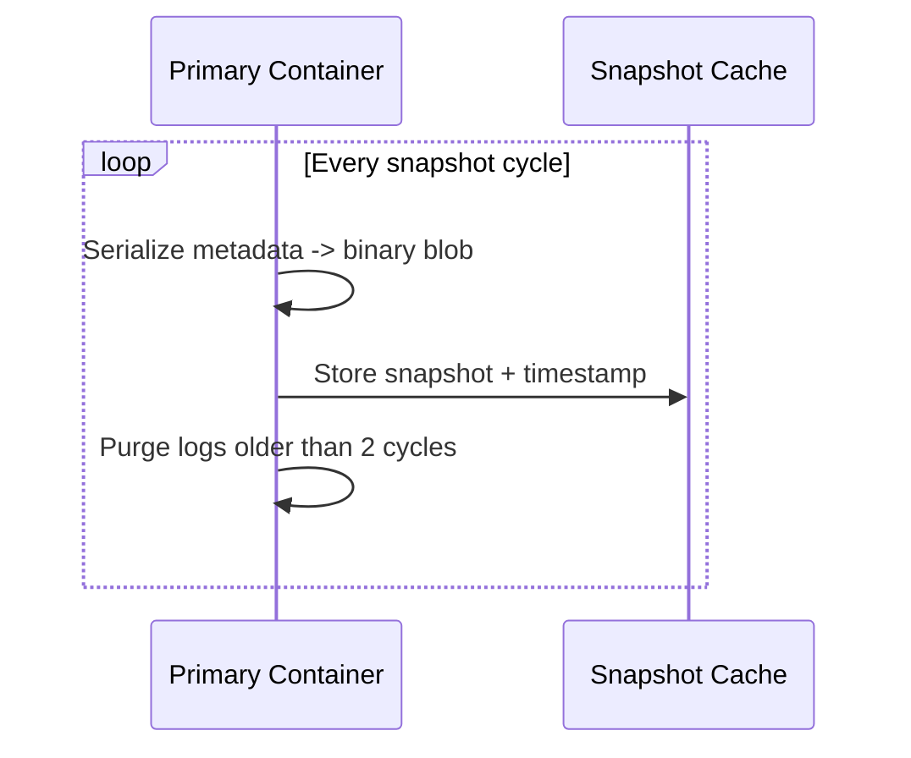

**Fallback logic detail:**

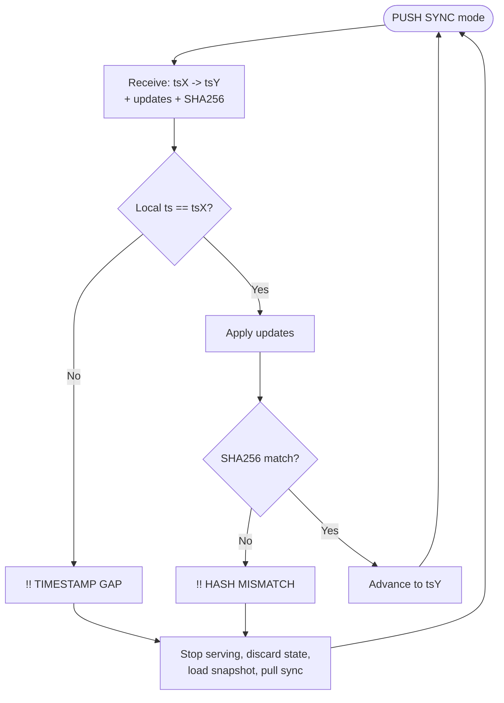

### 4.5 Split Service

Monitors container utilization and rebalances content using a **two-threshold hysteresis design** (Threshold_1 triggers the split; Threshold_2, a lower value, stops it — preventing oscillation).

**Process:**

1. Periodic utilization check on each container.
2. If utilization > Threshold_1 **and more than 1 folder**: find an under-utilized container or create a new one.
3. Register a batch job to move folder contents to the destination.
4. On completion: update content-location mapping on Primary (triggers metadata sync to all containers), then remove content from the source.
5. Re-check source container. If still > Threshold_2 **and more than 1 folder remains**, repeat from step 3.

**Monitoring and destination selection:**

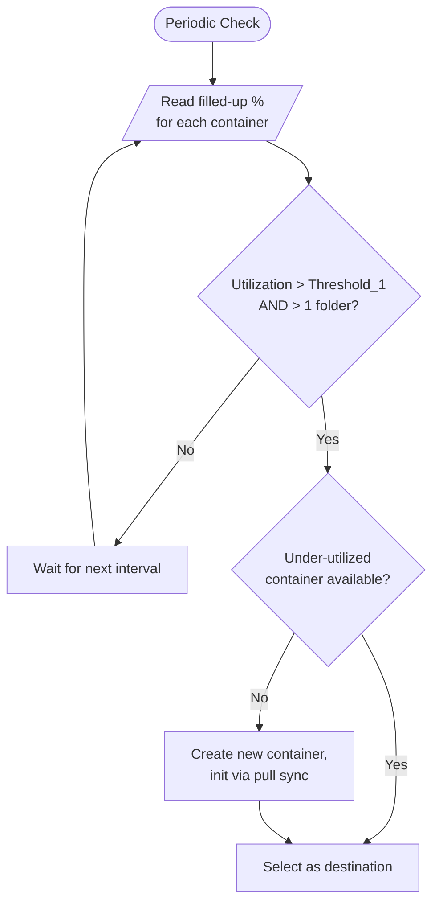

**Batch move, metadata update, and re-check loop:**

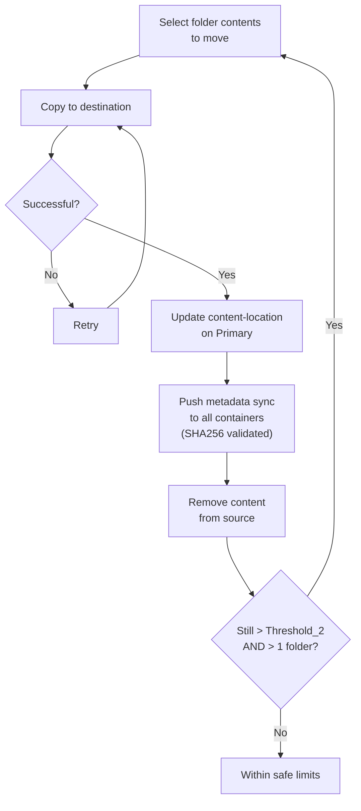

### 4.6 Availability Service

Ensures the system survives container and regional failures. Replaces the traditional "disaster recovery" concept with a design suited to **scattered peer containers** where outages are routine.

#### Active-Passive Pairs

Every container has a passive copy in a **different location** (different region, different VM, different physical site). The constraint: for any container, the active and passive copies must **never be co-located** (not on the same VM, not in the same region if cloud-hosted).

- The passive copy stays synchronized via the replication service but does not serve client traffic during normal operation.
- On active container failure, the passive copy is **promoted to active** and begins serving traffic.
- When the original container recovers, it goes through pull sync catch-up and becomes the passive copy.

#### Proactive Rotation

To prevent the passive copy from becoming stale or untested, the system **periodically promotes the passive copy to active** even during normal operation:

- The current active is gracefully demoted to passive.
- The former passive takes over as active.
- This validates that the passive copy can serve real traffic, exercises the promotion path, and ensures both copies are battle-tested.

#### Leader Election (Primary Permanently Lost)

If the primary container is permanently unavailable:

1. Remaining containers enter a **consensus process**.
2. The elected leader must have a valid `SHA256(metadata)` + timestamp pair — cryptographic proof that its metadata is current and uncorrupted.
3. After election: Routing Service is updated, cache and subscriptions are reset, and **all containers re-enter pull sync** from the new primary.

---

## 5. End-to-End Client Flow

This diagram shows a complete session — applicable to both a user and an AI agent connecting via MCP. The flow is identical; only the client protocol differs.

**Connect, browse, and content access:**

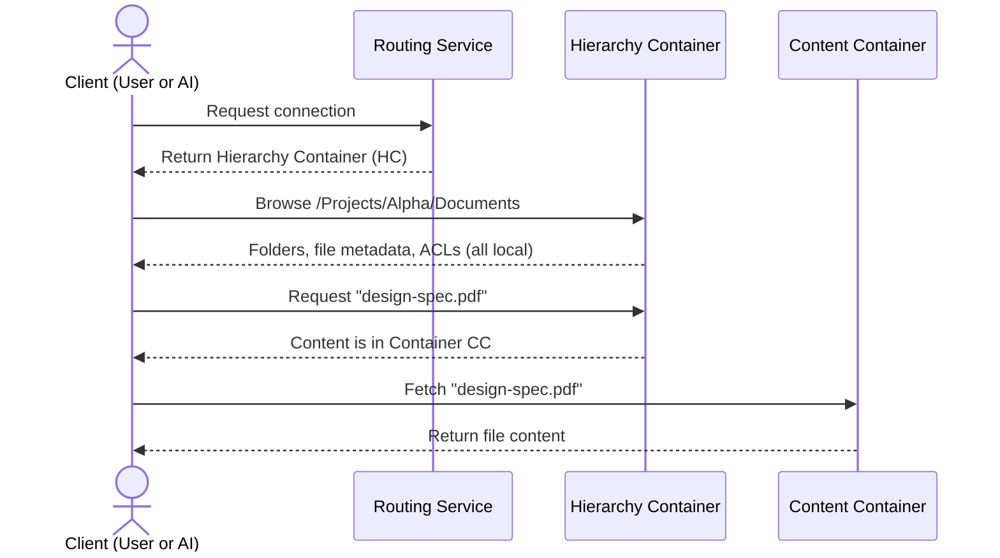

**Content create and folder update:**

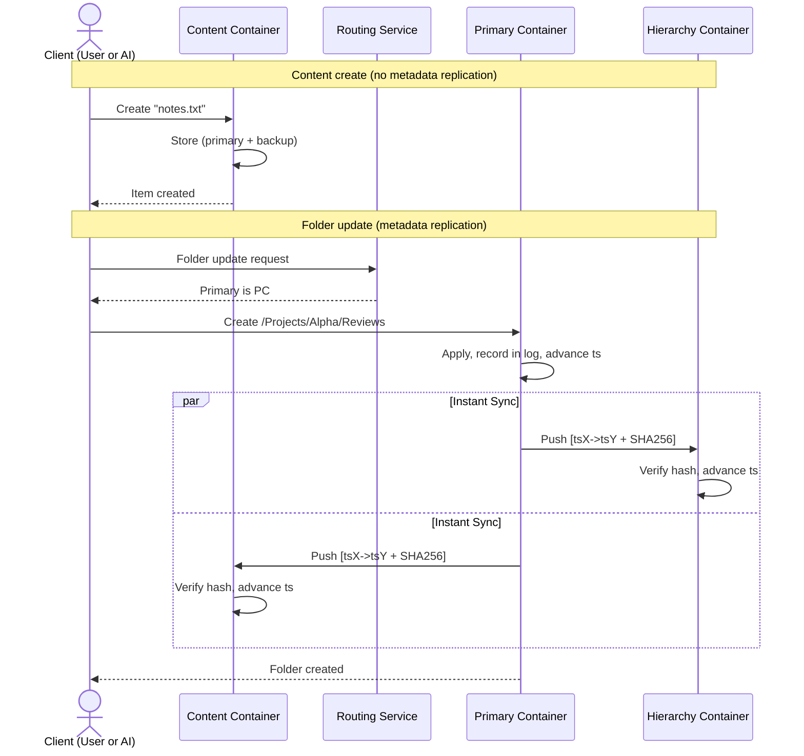

| Phase | Communication | Key Property |
|-------|--------------|-------------|
| Connect | Client -> Routing Service | Load + freshness aware selection |
| Browse | Client <-> Hierarchy Container only | All metadata local — no cross-container hops |
| Content access | HC provides location; Client -> Content Container | Decoupled from metadata path |
| Content create | Client <-> Content Container only | No metadata replication |
| Folder update | Client -> Primary -> sync to all | Namespace change — replicated via SHA256-validated push |

---

## 6. Failure Handling

| Failure | Detection | Recovery |
|---------|-----------|----------|
| Missed push notification | Timestamp gap | Fallback to pull sync |
| Data corruption | SHA256 hash mismatch | Discard local state, reload snapshot, pull sync |
| Network outage | Unable to confirm contiguous timestamp | Stop serving, pull sync on reconnection |
| Container failure | Routing detects unreachable | Redirect traffic; promote passive copy |
| Primary permanently lost | Consensus timeout | Leader election (SHA256 + timestamp validated); all containers pull-sync from new primary |

**Invariant:** No container ever serves metadata it cannot verify as correct. Every disruption has a deterministic, automated recovery path.

---

## 7. Summary

| Property | Mechanism |
|----------|-----------|
| **Symmetric peer containers** | Every container carries full metadata; any can serve hierarchy; easily replaceable |
| **No dedicated infrastructure required** | Containers run on any networked machine — cloud VMs, on-premises, mixed |
| **Dual-client access (User + AI)** | MCP endpoint on every metadata-serving container; Routing Service treats AI as first-class client |
| **No single point of failure** | Primary is elected, not permanent; passive copies are proactively rotated |
| **Stale data prevention** | SHA256 + timestamp validation on every sync cycle |
| **Self-healing** | Automatic push-to-pull fallback; snapshot reload on corruption |
| **Efficient over slow links** | Only namespace operations replicate; content operations stay local |
| **Automatic rebalancing** | Split Service with two-threshold hysteresis; retry on failure |
| **Scattered availability** | Active-passive pairs never co-located; proactive rotation validates readiness |
| **Deterministic recovery** | Every failure scenario converges to the same self-healing sequence |
